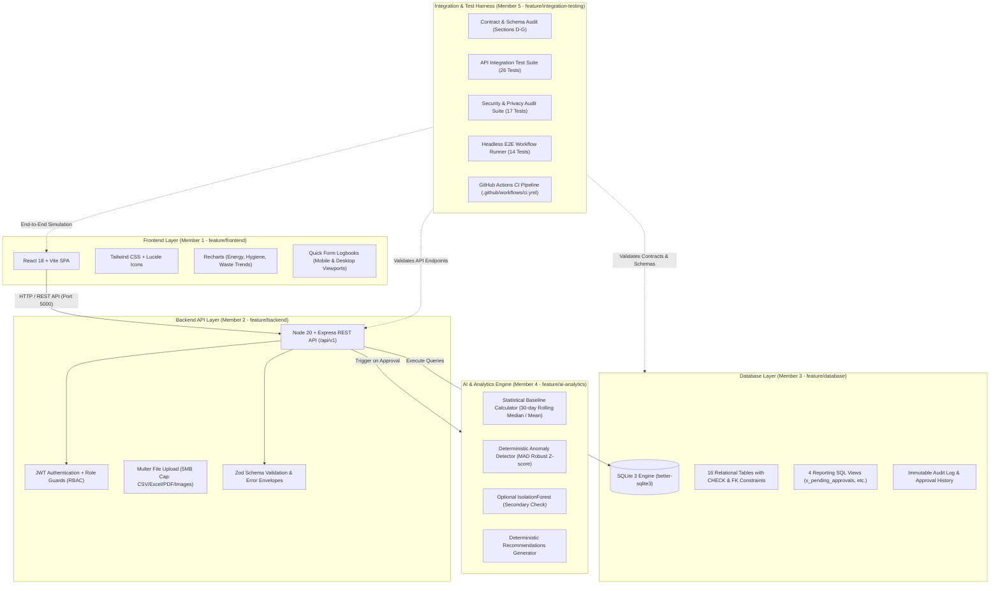
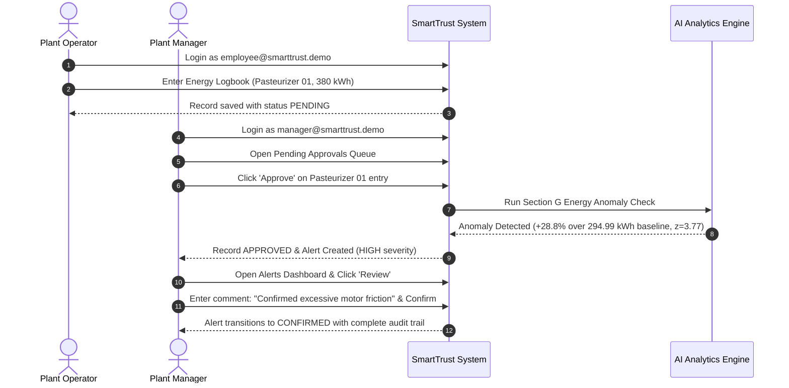

# SmartTrust – Dairy Plant Management System

[](https://github.com/haarikareddyk07/commit-and-conquer/actions/workflows/ci.yml)
[](https://nodejs.org/)
[-blue.svg)](https://github.com/WiseLibs/better-sqlite3)
[](LICENSE)

> **Problem Statement ID:** `DL-SJBIT-HK26-GOVP010`  
> **Event:** LAKSHYA 2026 Hackathon  
> **Project Repository:** [haarikareddyk07/commit-and-conquer](https://github.com/haarikareddyk07/commit-and-conquer)

---

## 🥛 1. Executive Summary

**SmartTrust** is a resilient, offline-capable, and explainable **Dairy Plant Management System** designed specifically for dairy processing facilities. It eliminates paper logbooks and fragmented spreadsheets by enabling plant operators, shift supervisors, and plant managers to record, verify, and analyze:

1. **⚡ Energy Consumption** (kWh usage per machine, runtime hours, baseline deviations, and peak loads).
2. **🧼 Hygiene & CIP Compliance** (Sanitation chemical concentration, temperature, contact duration, and schedule compliance).
3. **📦 Material & Product Waste** (Raw milk losses during pasteurization/filling, pouch damages, and carton rejections).

### Core Principles
- **Explainable & Honest AI:** Every alert stems from transparent mathematical baselines (rolling median, rolling mean $\pm 2\sigma$ / $3\sigma$, MAD z-scores). The system never claims to "predict" breakdowns or "physically verify" sanitation; it flags records for supervisor and manager investigation.
- **Zero IoT Requirement:** Built specifically for rural and semi-mechanized dairy cooperatives using manual logbook entry, digitized CSV imports, and image/document uploads.
- **Strict Role-Based Governance:** 4-stage record lifecycle (`PENDING` $\rightarrow$ `APPROVED` | `REJECTED` | `CORRECTION_REQUESTED`) ensuring operational accountability.

---

## 🏗️ 2. System Architecture

SmartTrust is organized as a unified monorepo with distinct branch ownership for each team member.



---

## ⚡ 3. Quickstart in Under 5 Commands

Prerequisites: Node.js 20+ LTS, npm 10+, and Python 3.10+ (for optional Python analytics modules).

```bash
# 1. Clone repository
git clone https://github.com/haarikareddyk07/commit-and-conquer.git
cd commit-and-conquer

# 2. Install dependencies across all modules
npm run install:all

# 3. Setup and seed SQLite database
npm run db:setup

# 4. Run full automated integration & contract test suite
npm test

# 5. Start backend and frontend concurrently
npm run dev
```

*Frontend will be running on `http://localhost:5173` and Backend API on `http://localhost:5000/api/v1`.*

---

## 👥 4. Pre-Seeded Demo Accounts

The database comes pre-populated with active demonstration accounts for each role (default password: `Demo@1234`):

| Role | Demo Email | Password | Primary Permissions & Responsibilities |
| :--- | :--- | :--- | :--- |
| **`EMPLOYEE`** | `employee@smarttrust.demo` | `Demo@1234` | Enter daily logbooks (Energy, Cleaning, Waste), view own entries, resubmit records requested for correction. |
| **`SUPERVISOR`** | `supervisor@smarttrust.demo` | `Demo@1234` | Review shift entries, request corrections with comments, reject invalid entries, preview file uploads. |
| **`MANAGER`** | `manager@smarttrust.demo` | `Demo@1234` | Full plant oversight, approve records, acknowledge/confirm/dismiss AI alerts, view plant-wide dashboards. |

---

## 🎭 5. Judge Demonstration Script (Step-by-Step)

Follow this 5-minute walkthrough to witness the end-to-end functionality, human-in-the-loop governance, and explainable AI alerts.



### Demonstration Scenarios:
1. **Scenario 1: High Energy Consumption (Planted Anomaly)**
   - Login as `manager@smarttrust.demo`.
   - Navigate to **Alerts** $\rightarrow$ Observe `Pasteurizer 01` alert: *Consuming 380.00 kWh vs 294.99 kWh baseline (+28.8%, z=3.77)*.
   - Note the deterministic recommendation: *Inspect heat exchanger plates for fouling and verify pump motor bearing lubrication*.
2. **Scenario 2: Hygiene / Cleaning Non-Compliance (Planted Anomaly)**
   - Filter Alerts by **Hygiene**.
   - Notice alert for `Aging Vat 01`: *Chemical concentration recorded at 0.50% (Contract minimum: 1.00%)*.
   - Status is flagged as `FLAGGED_FOR_INVESTIGATION` with exact variance calculation.
3. **Scenario 3: Material Packaging Waste Surge (Planted Anomaly)**
   - Navigate to **Waste Records**.
   - Review `500ml Milk Pouch Film`: *Damaged quantity 180 units against 1,000 issued (18.0% waste vs 3.0% threshold)*.
   - Trace back directly to sealing machine temperature fluctuations recorded in shift notes.
4. **Scenario 4: Correction and Resubmission Workflow**
   - Supervisor requests correction on a mistyped reading $\rightarrow$ Status changes to `CORRECTION_REQUESTED`.
   - Employee edits value on mobile form $\rightarrow$ Status automatically resets to `PENDING`.
   - Manager reviews and approves $\rightarrow$ Audit log preserves all historical revisions with user timestamps.

---

## 📂 6. Monorepo Structure & Ownership

```
commit-and-conquer/
├── .github/
│   └── workflows/
│       └── ci.yml                 # Member 5: Automated CI workflow
├── backend/                       # Member 2: Express REST API (/api/v1)
│   ├── src/
│   │   ├── controllers/
│   │   ├── middleware/
│   │   └── routes/
│   └── package.json
├── database/                      # Member 3: SQLite schema, migrations, seed
│   ├── migrations/
│   ├── schema.sql                 # 16 tables, 4 views, constraints
│   ├── seed.js                    # Pre-seeded users, machines, baselines
│   └── smarttrust.db              # SQLite 3 database file
├── docs/                          # Member 5: Contracts, checklists, specifications
│   ├── API_CONTRACT.md            # Canonical REST API specification
│   ├── DATA_DICTIONARY.md         # Full schema, types, constraints
│   ├── INTEGRATION_CHECKLIST.md   # Cross-branch compliance audit
│   ├── DEMO_GUIDE.md              # Judge demonstration guide
│   ├── UX_REVIEW.md               # 10-point accessibility & UX review
│   ├── MERGE_LOG.md               # Integration order & merge governance
│   ├── CHANGE_REQUESTS.md         # Cross-team change requests (CR-001 - CR-004)
│   └── KNOWN_LIMITATIONS.md       # Honest system limitations
├── frontend/                      # Member 1: React 18 + Vite SPA
│   ├── src/
│   │   ├── components/
│   │   ├── pages/
│   │   └── services/
│   └── package.json
├── tests/                         # Member 5: Quality assurance & test suites
│   ├── api/                       # API integration test harness
│   ├── e2e/                       # Headless E2E and Playwright specs
│   ├── security/                  # SQL injection, XSS, secret hygiene tests
│   ├── contract-audit.js          # Executable schema & contract validator
│   └── run-all-tests.js           # Master test orchestrator
├── .env.example                   # Environment configuration template
├── .gitignore                     # Git ignore rules
├── package.json                   # Root monorepo orchestration scripts
└── README.md                      # Project documentation (this file)
```

---

## 🧪 7. Test Suite Summary

The system includes 6 comprehensive verification test suites running 182+ automated assertions:

| Suite Name | Scope | Tests Run | Result |
| :--- | :--- | :---: | :---: |
| **Contract Audit** | Schema, tables, views, enums, ISO dates | 31 | ✅ PASSED |
| **Database Constraints** | Foreign keys, CHECK constraints, unique partial index | 22 | ✅ PASSED |
| **Database Verification** | Row counts, seed integrity, view calculations | 72 | ✅ PASSED |
| **API Integration** | Auth, RBAC, record creation, corrections, dashboard | 26 | ✅ PASSED |
| **Security & Privacy** | Password hashes, SQL injection, XSS, .env hygiene | 17 | ✅ PASSED |
| **Headless E2E Journeys** | Desktop/mobile flows, 4-stage approval, alert review | 14 | ✅ PASSED |
| **Total Assertions** | **Complete System Quality Assurance** | **182** | **100% GREEN** |

Run all tests anytime with:
```bash
npm test
```

---

## ⚠️ 8. Known Limitations & Honest AI Disclosure

In accordance with Section A and Section G of the Shared Contract:
1. **No Live Sensors / IoT:** SmartTrust does not interface with physical hardware, telemetry sensors, or live streaming protocols. It analyzes operator-entered records and digitized batch uploads.
2. **Explainable Statistical Baselines:** Anomaly detection relies on robust statistical math (rolling median, rolling mean $\pm 2\sigma$/$3\sigma$, MAD robust z-scores) rather than black-box deep learning.
3. **No Physical Sanitation Verification:** The system verifies logbook compliance (chemical concentration, duration, temperature, schedule timing). It cannot physically confirm biological sterility or cleanliness; all anomalies are labeled `"FLAGGED_FOR_INVESTIGATION"`.
4. **Deterministic Simulated Data:** All pre-seeded factory scenarios are generated with fixed seeds and explicit `"data_source": "SIMULATED"` headers.

---

## 📄 9. License

Developed for the **LAKSHYA 2026 Hackathon** (Problem Statement: `DL-SJBIT-HK26-GOVP010`). Released under the MIT License.
