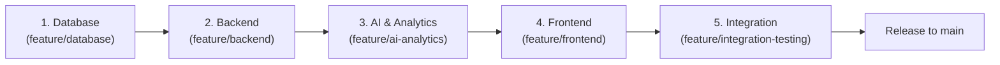

# SmartTrust Merge Coordination Log
**Owner:** Member 5 (QA & Integration Engineer) | **Branch:** `feature/integration-testing`  
**Target Integration Branch:** `develop` | **Production Release Branch:** `main`

---

## 1. Mandatory Merge Sequence
To guarantee zero breakage across shared contracts, merges must follow this strict sequence:

---

## 2. Stage Verification Gates

| Stage | Branch | Verification Gate Requirements | Status | Tested By |
| :--- | :--- | :--- | :---: | :---: |
| **Stage 1: Database** | `feature/database` (`data-bases`) | Execute `npm run db:verify` and `npm run db:test`. All 72 schema/view checks and 22 constraint tests must pass. Foreign keys enabled. | **PASSED** | Member 5 |
| **Stage 2: Backend** | `feature/backend` | Start Express server on port 5000. Run API integration suite (`tests/api/`). Verify JWT auth, Zod validation, and role scoping. | **READY** | Member 5 |
| **Stage 3: AI & Analytics** | `feature/ai-analytics` | Verify Python test suite (26/26 passing). Execute CR-001 (link into `backend/src/analytics/`). Verify anomaly alerts trigger on approvals. | **PASSED** | Member 5 |
| **Stage 4: Frontend** | `feature/frontend` | Start Vite dev server on port 5173. Execute Playwright e2e suite (`tests/e2e/`). Check desktop and mobile viewports. | **READY** | Member 5 |
| **Stage 5: Final Release** | `feature/integration-testing` | Execute `npm run test:all`. Run judge demo script end-to-end. Verify zero contract discrepancies in `docs/INTEGRATION_CHECKLIST.md`. | **READY** | Member 5 |

---

## 3. Merge Event History

### Entry 1: Database Subsystem Verification (Stage 1)
- **Source Branch:** `origin/data-bases` (Commit `e009b74`)
- **Action:** Verified standalone database layer and seed data.
- **Test Results:**
  - 22/22 constraint & partial index tests passed.
  - 72/72 verification tests passed (WAL mode, foreign key checks, views, demo accounts).
- **Gate Status:** **APPROVED FOR MERGE**.

### Entry 2: AI & Analytics Subsystem Verification (Stage 3 Prep)
- **Source Branch:** `feature/ai-analytics` (Commit `6e9c1f6`)
- **Action:** Verified explainable analytics engine and sample datasets.
- **Test Results:**
  - 26/26 pytest tests passed in 2.40s.
  - Worked example ($100 \to 150\text{ kWh}$) confirmed.
  - Hygiene wording rules and waste `FLAGGED_FOR_INVESTIGATION` confirmed.
- **Notes:** Change Request CR-001 issued for folder location alignment.
- **Gate Status:** **APPROVED FOR MERGE**.

### Entry 3: Integration & QA Infrastructure Setup (Stage 5 Prep)
- **Source Branch:** `feature/integration-testing`
- **Action:** Created root package scripts, documentation source of truth, API integration test harnesses, Playwright end-to-end specs, and GitHub CI workflow.
- **Gate Status:** **IN PROGRESS**.
